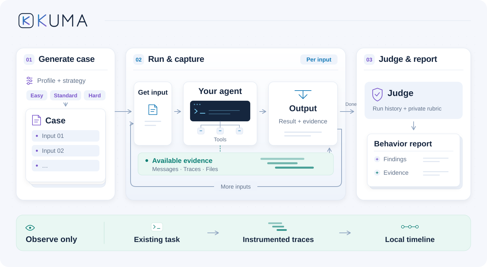

<p align="center">
  
</p>

<h1 align="center">KUMA</h1>

<p align="center">
  <strong>KUMA Python SDK</strong><br>
  Knowledge-grounded Universal Measurement for Agents
</p>

<p align="center">
  <a href="README.md">English</a> &nbsp;|&nbsp; <a href="README.zh-CN.md">Simplified Chinese</a>
</p>

KUMA is a framework-neutral Python SDK for evaluating AI Agents. It delivers a
test Case as step-by-step Inputs, captures bounded Evidence, and produces a
Judgment through official or custom Providers. KUMA does not run your Agent or
expose private evaluation logic.

<picture>
  <source media="(prefers-color-scheme: dark)" srcset="docs/assets/kuma-workflow-dark.svg">
  
</picture>

## What you can do

- Run repeatable Case-to-Judgment evaluations.
- Use official services or custom Case and Judge Providers, including fully
  local workflows.
- Capture structured Evidence from results, file changes, logs, and optional
  OpenTelemetry traces.
- Select a versioned Strategy Group and describe the Agent with an Agent Profile.

## Install

Version 0.3.10 adds optional Java/external-process Trace capture over local OTLP,
with a free two-input Java example. Existing Run and Judge workflows are
unchanged. See [release notes](docs/releases.md).

Requires Python 3.10 or newer:

```bash
python -m pip install --upgrade kuma-defuzex
```

The package is `kuma-defuzex`; Python imports and the CLI use `kuma`.

## Capture normal execution (0.5.0)

Install the capture extra matching your Agent, then wrap its normal invocation:

```python
from kuma import capture

task = "The actual original task for this run."
with capture(task, framework="langgraph") as recorded:
    answer = my_agent.invoke({"messages": [("user", task)]})
print(recorded.capture_id)
```

KUMA automatically saves redacted data outside the workspace by default. In another process:

```sh
python -m kuma captures export cap_REPLACE_WITH_PRINTED_ID --output capture.json
python -m kuma captures judge cap_REPLACE_WITH_PRINTED_ID --output review.json
```

Only explicit Judge needs `KUMA_API_KEY` and can settle the existing Judge fee.
No hand-built ATIF or requirements file is needed for this flow. Preserve the same
capture/rules/key after timeout. See the [capture guide](https://github.com/DefuzeX-AI/KUMA-DefuzeX/blob/main/docs/capture-lifecycle.md)
for installation, supported integrations, task/tool rules, storage and honest gaps.

KUMA 0.7.0 also supports explicit per-operation original-content retention after a
warning. Read the [privacy and persistence boundary](docs/capture-lifecycle.md#explicit-original-content)
before using `redact_sensitive=False`; previously redacted data cannot be recovered.

## Trajectory Judge: one Kuma Key

From 0.4.0, review an existing trace without generating Cases or rerunning the Agent.
Set `KUMA_API_KEY` with `sdk:observe` and `judge:run`; no model or storage key is needed.

```python
from kuma import KumaClient

workspace = KumaClient().trajectory()
trace = workspace.upload_atif(atif_document, requirements)
review = workspace.evaluate(trace["id"], idempotency_key="my-run-001-review-01")
```

[Quick start, task/tool template and runnable example](https://github.com/DefuzeX-AI/KUMA-DefuzeX/blob/main/docs/trajectory-platform.md).
Only completed validated reviews settle the configured Judge fee. Reuse the same key/input
on timeout. Reports preserve source locations, unknowns, normal retries and actual coverage.

## Quick start

Run a deterministic local check without an account, API key, Docker, or network:

```bash
kuma quickstart
```

Successful output starts with:

```text
Local check: PASS
Score: 100/100
Reason: Output exactly matched the published rule.
```

This checks the bundled local example, not your Agent or the hosted Judge.
To evaluate your Agent, follow the [SDK guide](docs/sdk-guide.md).

For official Case generation, `create_run(..., difficulty="D1")` selects challenge
count and intensity: D0 injects zero problems; D1 injects one obvious, low-intensity
problem; D2 injects two subtler or composed problems requiring stronger recognition,
recovery and verification. Necessary inputs and solvability must be preserved.
`max_steps` remains the same upper bound; D2 does not add a step or change Judge
severity. No measured failure rate is promised; the service builds the challenge.

File tracking stays within `repo_path` and skips descendant junctions or other
reparse points, reporting incomplete capture. An explicitly configured external
`storage_path` remains supported and does not expand the file tracking boundary.

## Next steps

- [Run an official evaluation](docs/sdk-guide.md) with the full Case and Judge workflow.
- [Observe an Agent locally](docs/observation.md) without a Case, Judge, or
  automatic upload.
- [Connect a Java Agent](examples/java_agent/README.md) and capture observed model
  and tool calls with the official Java OpenTelemetry exporter.
- [Try the full-stack example](examples/full_stack/README.md) with KUMA and
  mini-SWE-agent in Docker. It may use service credit and model budget.

## Documentation

[SDK guide](docs/sdk-guide.md) · [Python API reference](docs/api-reference.md) ·
[Versions and releases](docs/releases.md) · [Detailed Judge assessment](docs/judge-assessment.md)

## Project

[Security](SECURITY.md) · [Contributing](CONTRIBUTING.md) · [Apache License 2.0](LICENSE)
