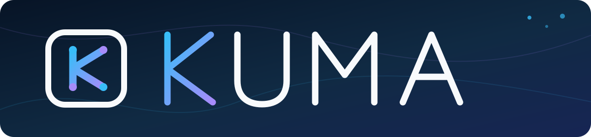
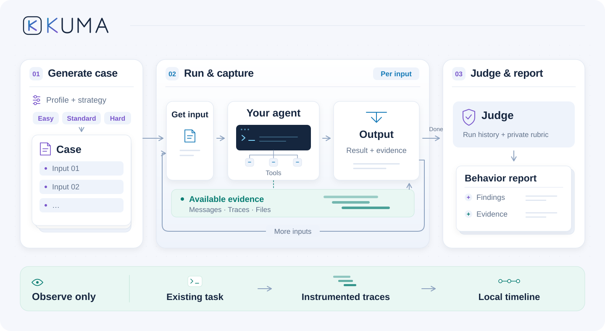

<p align="center">
  
</p>

<h1 align="center">KUMA</h1>

<p align="center">
  <strong>KUMA Python SDK</strong><br>
  面向 Agent 的知识与证据驱动通用评测
</p>

<p align="center">
  <a href="README.md">English</a> &nbsp;|&nbsp; <a href="README.zh-CN.md">简体中文</a>
</p>

KUMA 是一个不绑定框架的 Python SDK，用于评测 AI Agent。它将测试 Case
按步骤交付为 Input，采集有界 Evidence，并通过官方或自定义 Provider 生成
Judgment。KUMA 不负责运行被测 Agent，也不公开私有评测逻辑。

<picture>
  <source media="(prefers-color-scheme: dark)" srcset="docs/assets/kuma-workflow-dark.svg">
  
</picture>

## 可以做什么

- 运行可重复的 Case-to-Judgment 评测。
- 使用官方服务或自定义 Case 和 Judge Provider，包括全本地流程。
- 从结果、文件变更、日志和可选 OpenTelemetry Trace 中采集结构化 Evidence。
- 选择带版本的 Strategy Group，并通过 Agent Profile 描述被测 Agent。

## 安装

0.3.10 版本新增可选的 Java／外部进程 Trace 采集，通过本地 OTLP 接入，并提供免费的两轮 Java 示例。原有 Run 和 Judge 流程保持兼容。详见[发布说明](docs/releases.md)。

需要 Python 3.10 或更高版本：

```bash
python -m pip install --upgrade kuma-defuzex
```

安装包名为 `kuma-defuzex`，Python 导入和命令行名称均为 `kuma`。

## 采集正常执行过程（0.5.0）

安装适合 Agent 的采集扩展，在正常调用外包一层即可：

```python
from kuma import capture

task = "本次运行当时收到的原始任务。"
with capture(task, framework="langgraph") as recorded:
    answer = my_agent.invoke({"messages": [("user", task)]})
print(recorded.capture_id)
```

结束后自动脱敏保存到工作区外。另开进程，使用打印出的 ID：

```sh
python -m kuma captures export cap_REPLACE_WITH_PRINTED_ID --output capture.json
python -m kuma captures judge cap_REPLACE_WITH_PRINTED_ID --output review.json
```

普通采集和导出不联网、不调用 Judge；显式评审只需一个有相应权限的
`KUMA_API_KEY`，按既有固定费率结算。无需手写 ATIF 或另填要求 JSON。
超时后保持相同轨迹、规则和请求 Key 恢复，不会自动重跑 Agent。
详见[完整接入说明](https://github.com/DefuzeX-AI/KUMA-DefuzeX/blob/main/docs/capture-lifecycle.md)，包括支持范围、工具规则和缺证据的情况。

## 轨迹 Judge：只需一个 Kuma Key

从 0.4.0 起，直接提交已有轨迹和原始任务要求，不用生成 Case 或重新运行 Agent。
设置 `KUMA_API_KEY`，同一个 Key 需要 `sdk:observe`、`judge:run` 权限；
不需要 DeepSeek、OpenRouter 或数据库 Key。

```python
from kuma import KumaClient

workspace = KumaClient().trajectory()
trace = workspace.upload_atif(atif_document, requirements)
review = workspace.evaluate(trace["id"], idempotency_key="my-run-001-review-01")
```

[完整接入步骤、任务/工具模板与可运行示例](https://github.com/DefuzeX-AI/KUMA-DefuzeX/blob/main/docs/trajectory-platform.md)。
仅完成并校验通过的评审结算既有 Judge 固定费用；超时后使用相同输入和请求 Key 恢复。
正常重试不自动扣分，缺证据就说无法确认，并保留具体步骤位置和实际评审覆盖。
读取/导出另需 `sdk:read` 权限，旧 Key 不会被静默增加权限。

## 快速开始

无需账号、API Key、Docker 或网络即可运行确定性的本地检查：

```bash
kuma quickstart
```

成功时，输出开头为：

```text
Local check: PASS
Score: 100/100
Reason: Output exactly matched the published rule.
```

这只验证内置的本地示例，不代表你的 Agent 已通过评测，也不会调用托管 Judge。
要评测自己的 Agent，请继续阅读 [SDK 指南](docs/sdk-guide.md)。

官方 Case 可用 `create_run(..., difficulty="D1")` 选择问题数量和挑战强度：D0 不注入；D1（默认）注入一个明显、低强度的问题；D2 注入两个更隐蔽或组合的问题，要求更强的识别、恢复和验证能力。必须保留必要输入和可解性；`max_steps` 仍是原有上限，D2 不表示额外增加一步。不改变 Judge 评分严格程度，也不承诺实际失败率；具体挑战由服务端构建。

## 下一步

- [运行官方评测](docs/sdk-guide.md)，完成完整的 Case 与 Judge 流程。
- [在本地观察 Agent](docs/observation.md)，无需 Case、Judge 或自动上传。
- [接入 Java Agent](examples/java_agent/README.md)，使用官方 Java OpenTelemetry
  导出器采集实际模型和工具调用。
- [运行全栈示例](examples/full_stack/README.zh-CN.md)，在 Docker 中组合 KUMA
  与 mini-SWE-agent；该流程可能消耗服务 Credit 和模型预算。

## 文档

[SDK 指南](docs/sdk-guide.md) · [Python API 参考](docs/api-reference.md) ·
[版本与发布](docs/releases.md) · [详细 Judge 评估](docs/judge-assessment.md)

## 项目链接

[安全策略](SECURITY.md) · [贡献说明](CONTRIBUTING.md) · [Apache License 2.0](LICENSE)
